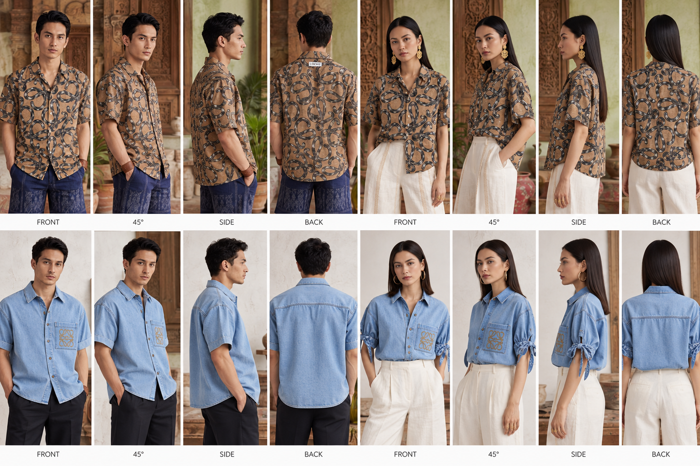
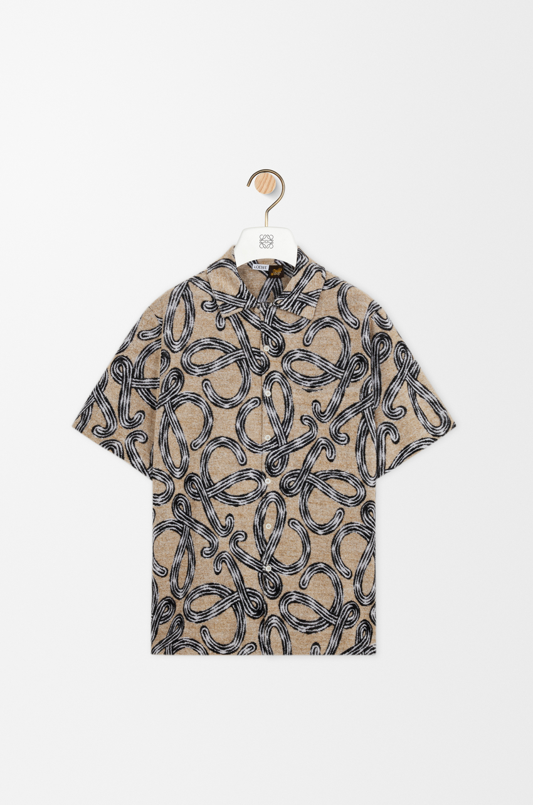
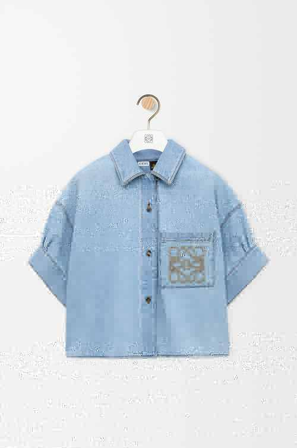
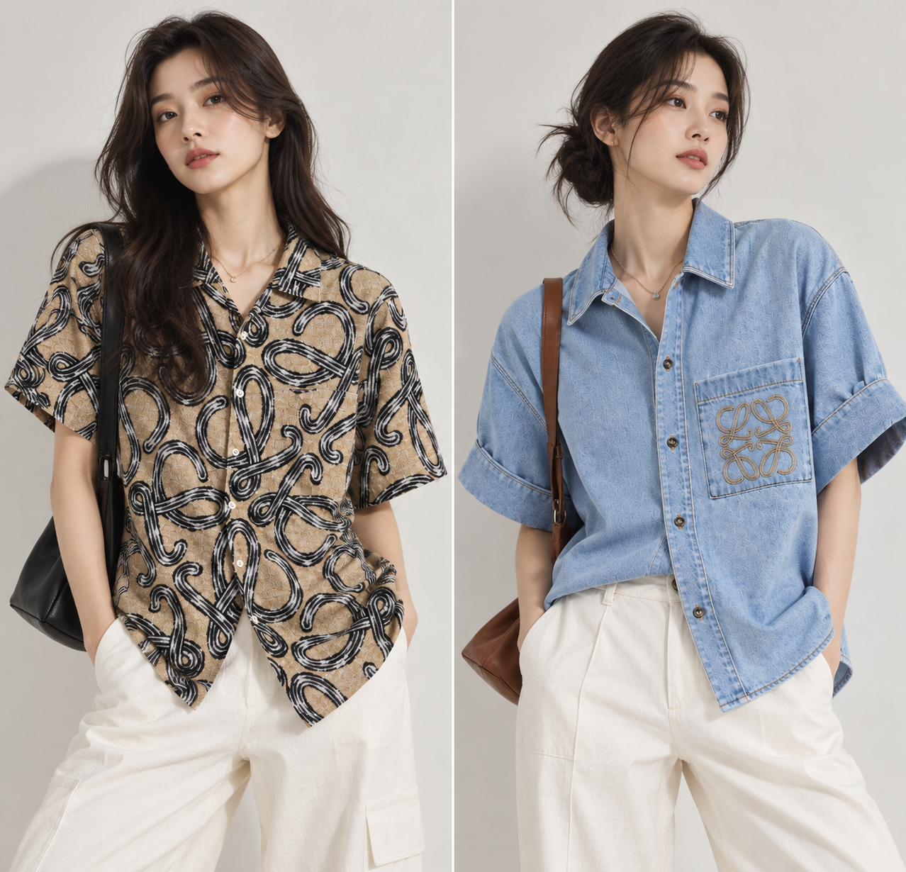

# Modelify AI

<p align="center">
  <strong>面向现代电商的 AI 时尚模特图生成平台。</strong>
</p>

<p align="center">
  将服装商品图快速转化为高质量 AI 模特图，用于独立站店铺、商品详情页、广告投放和社交媒体内容，无需传统高成本摄影棚拍摄。
</p>

<p align="center">
  <a href="https://modelify.fit"><strong>立即免费体验 Modelify →</strong></a>
</p>

<p align="center">
  <a href="README.md">English</a> ·
  <a href="README.zh-CN.md">简体中文</a>
</p>

<p align="center">
  
  
  
  
</p>

---

## 生成效果示例

以下为 Modelify 工作流中的真实案例，包含商品原图输入与生成的时尚模特效果。

### 多角度生成

<p align="center">
  
</p>

<p align="center">
  <sub>支持正面、45° 斜侧面、正侧面和背面等多角度商品展示。</sub>
</p>

### 商品输入原图

<table>
  <tr>
    <td align="center" width="50%">
      
      <br />
      <sub><b>花纹衬衫输入图</b></sub>
    </td>
    <td align="center" width="50%">
      
      <br />
      <sub><b>牛仔衬衫输入图</b></sub>
    </td>
  </tr>
</table>

### Lifestyle / Campaign 生成效果

<p align="center">
  
</p>

<p align="center">
  
</p>

<p align="center">
  <sub>可生成适合 Lifestyle、Catalog 和 Campaign 等不同风格的时尚商品素材。</sub>
</p>

---

## 免费 Fashion AI 资源与实战手册（Cookbook）

如果你正在做 AI 服装摄影、独立站视觉升级或跨境电商测款，可以从这些精选资源开始：

### 📖 电商实战 Cookbook
- **[时尚电商 AI Cookbook](cookbook/README.zh-CN.md)** — 核心工作流与电商商用质量原则
- **[原图准备指南](cookbook/source-image-preparation.zh-CN.md)** — 如何拍摄和准备更适合 AI 生成的服装平铺/人台图
- **[Fashion Prompt Library](cookbook/prompt-library.zh-CN.md)** — Catalog、Editorial、Streetwear 等高成片率可复用 Prompt
- **[多角度一致性生成指南](cookbook/multi-angle-generation.zh-CN.md)** — 正面、45° 斜侧面、正侧面与背面视角一致性解决方案
- **[Shopify 商品图工作流](cookbook/shopify-workflow.zh-CN.md)** — 从单个 SKU 到全店发布的可重复标准化流程
- **[常见失败问题排查](cookbook/troubleshooting.zh-CN.md)** — 解决服装变形、颜色偏移、Logo 扭曲与多图不一致

### 📚 进阶深度指南
- **[电商 Prompt 实战指南](docs/prompt-guide.zh-CN.md)** — 核心 5 层架构公式与各服装细分品类提示词拆解
- **[全链路落地工作流](docs/ai-fashion-workflow.zh-CN.md)** — 从原图到详情页上线的 5 步全流程流水线
- **[商业落地场景与 ROI 指南](docs/ecommerce-use-cases.zh-CN.md)** — 传统棚拍对比、测款策略与转化率提升实操
- **[出海增长与全渠道内容飞轮](docs/growth-guide.zh-CN.md)** — 3x3 广告买量矩阵、图片 SEO 与内容规模化

### 🛠️ 开发者与自动化工具
- **[服装原图合规预检脚本](examples/image-precheck.zh-CN.md)** — 自动检测原图分辨率、长宽比推荐与背景纯净度的 Python 工具
- **[API 概览](docs/api-overview.zh-CN.md)** — 开放 API 与 Webhooks 的架构设计理念
- **[cURL 示例](examples/curl-example.zh-CN.md)** — 示例 API 调用格式与工作流预期

> ⭐ **Star 本仓库**，方便随时查阅最新 Prompt 模板、电商避坑指南与自动化工具。

---

## Modelify 是什么？

Modelify 是一个专为时尚服装电商打造的 AI 商品摄影与模特生成平台。

它可以帮助出海品牌、Shopify 卖家和跨境电商供应链将普通的平铺图或人台图，一键转换为极具转化力的高级真人模特图，无缝应用于店铺商详页、宣传画册、付费买量广告和社交媒体。

### 核心优势
- 👗 **全品类真人模特生成：** 平铺图、隐形人台图、挂拍图均可生成
- 🌐 **全球多族裔模特库：** 覆盖多种人种、肤色、年龄与体型，精准匹配目标出海市场
- 📐 **工业级 4 视角一致性：** 单次生成正面、45° 斜侧面、正侧面与背面
- 💰 **降低 95% 以上拍摄成本：** 告别传统摄影棚和高昂模特租金，几秒内即时交付
- 🚀 **上新测款速度提升 10 倍：** 工厂样品出来即可上线测款，抢占测款先机

🌐 **立即体验 Modelify：** [https://modelify.fit](https://modelify.fit)

---

## Modelify 如何工作

```text
商品图片（平铺 / 人台 / 挂拍）
              │
              ▼
上传至 Modelify 自动智能预处理
              │
              ▼
选择模特人种、年龄体型与场景风格
              │
              ▼
AI 生成（4 视角空间与面料一致性引擎）
              │
              ▼
一键导出符合电商规范的成品大片（WebP / 店铺同步）
```

平台级技术设计请阅读 [架构概览](docs/architecture.zh-CN.md)。

---

## Roadmap

当前规划包括生成画质与稳定性的持续迭代、开放 Public API、Webhook 自动化、Shopify 独立站一键同步与批量化工具。

完整规划详见 [Roadmap](ROADMAP.zh-CN.md)。

---

## 开源边界

- **公开部分：** 文档、Cookbook 实战指南、Prompt 库、预检脚本、架构概览、集成说明、Roadmap 与社区反馈。
- **私有部分：** 商业化 SaaS 平台、Generation Worker 调度、AI Provider 智能路由、参数权重、队列架构与计费系统。

---

## 安全与贡献

- [安全策略](SECURITY.zh-CN.md)
- [贡献指南](CONTRIBUTING.zh-CN.md)

---

## License

本公开仓库中的资源与文档遵循 [Apache License 2.0](LICENSE)。

<p align="center">
  专为希望用极低运营成本打造顶级视觉效果的时尚电商团队而生。
</p>

<p align="center">
  <a href="https://modelify.fit"><strong>modelify.fit</strong></a>
</p>
